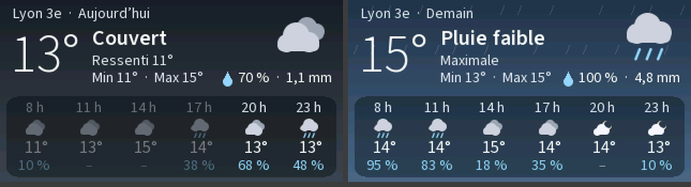

# Afficheur musique et météo pour T-Display S3

Un petit écran de bureau basé sur le [LilyGo T-Display S3](https://www.lilygo.cc/products/t-display-s3) (ESP32-S3, écran 320 × 170). Il affiche le morceau en cours de lecture sur un iPhone, avec la pochette de l'album, et bascule sur un écran météo d'un appui sur un bouton.



## Ce que ça fait

**Affichage musique**

- Titre, artiste, album et état lecture/pause du morceau en cours sur l'iPhone, quelle que soit l'app (Apple Music, Spotify, podcasts…).
- Pochette de l'album à gauche de l'écran.
- L'écran s'éteint quand l'iPhone n'est pas connecté ou qu'aucun morceau n'est en cours.

**Affichage météo**

- Temps actuel, température, ressenti, minimale et maximale du jour, probabilité et cumul de pluie.
- Prévisions sur six créneaux (8 h, 11 h, 14 h, 17 h, 20 h, 23 h) ; les créneaux passés sont estompés.
- Fond en dégradé adapté au temps actuel et au jour ou à la nuit.
- Vue du lendemain.

## Boutons

| Bouton | En musique | En météo |
|---|---|---|
| **B1** (GPIO14), appui simple | Lecture / pause | Aujourd'hui / demain |
| **B1**, double appui | Morceau suivant | Mise à jour immédiate |
| **B1**, maintenu 5 s | Efface l'appairage et redémarre | idem |
| **B2** (GPIO0) | Passe à la météo | Revient à la musique |

## Comment ça marche

L'enceinte n'intervient pas : tout passe par l'iPhone et le Wi-Fi.

- **Infos du morceau** : l'ESP32 s'annonce en Bluetooth Low Energy et s'appaire à l'iPhone. Il lit ensuite l'[Apple Media Service](https://developer.apple.com/library/archive/documentation/CoreBluetooth/Reference/AppleMediaService_Reference/Introduction/Introduction.html) (AMS), un service que l'iPhone expose aux accessoires appairés. L'iPhone peut rester connecté en parallèle à une enceinte en Bluetooth classique.
- **Pochette** : AMS ne la fournit pas. Elle est cherchée par artiste et titre via l'API de recherche iTunes, puis téléchargée en JPEG 170 × 170.
- **Météo** : prévisions [Open-Meteo](https://open-meteo.com/) (gratuit, sans compte), rafraîchies toutes les 15 minutes.
- **Commandes** : lecture/pause et morceau suivant sont envoyés à l'iPhone par la télécommande AMS.

## Installation

Prérequis : [PlatformIO](https://platformio.org/) et un réseau Wi-Fi en 2,4 GHz.

1. Copier `include/secrets.example.h` en `include/secrets.h` et y renseigner le nom et le mot de passe du Wi-Fi. Ce fichier est ignoré par git.
2. Dans `platformio.ini`, adapter `upload_port` au port série de la carte.
3. Compiler et flasher :

   ```bash
   pio run -t upload
   ```

4. Sur l'iPhone, ouvrir Réglages > Bluetooth, toucher « Now Playing » et accepter le jumelage. La reconnexion est ensuite automatique.

Si « Now Playing » n'apparaît pas dans les réglages, une app comme nRF Connect permet de lancer la première connexion.

## Adapter le projet

- **Ville de la météo** : latitude et longitude en haut de `src/weather.cpp`, libellé dans `src/weather_ui.cpp`.
- **Boutique iTunes** pour la recherche de pochettes : `ITUNES_COUNTRY` dans `src/artwork.cpp`.
- **Polices** : les tailles et graisses se règlent dans `tools/make_fonts.py`, qui régénère `src/fonts.cpp` à partir de `fonts/SourceSans3.ttf`. Le script demande Pillow :

  ```bash
  ~/.platformio/penv/bin/pip install pillow
  ```

  ```bash
  ~/.platformio/penv/bin/python tools/make_fonts.py
  ```

## Organisation du code

| Fichier | Rôle |
|---|---|
| `src/main.cpp` | BLE et AMS, boutons, affichage musique, bascule entre les deux écrans |
| `src/artwork.cpp` | Wi-Fi, recherche et téléchargement de la pochette |
| `src/weather.cpp` | Récupération des prévisions |
| `src/weather_ui.cpp` | Dessin de l'écran météo (fonds, pictogrammes, mise en page) |
| `src/fonts.cpp` | Polices lissées, générées par `tools/make_fonts.py` |

## Mise au point

Le firmware accepte quelques commandes sur le port série (115200 bauds, une par ligne) :

| Commande | Effet |
|---|---|
| `w` | Bascule musique / météo |
| `d` | Aujourd'hui / demain |
| `c63j`, `c0n`… | Force un code météo WMO, de jour (`j`) ou de nuit (`n`) ; `c` seul annule |
| `s` | Envoie l'image de l'écran météo (RGB565 en hexadécimal) |

## Limites connues

- La pochette est trouvée par recherche : si l'album exact n'est pas dans les résultats, c'est celle d'un autre album contenant le même titre qui s'affiche.
- Les polices couvrent l'alphabet latin accentué ; les autres écritures et les emoji s'affichent comme des rectangles.
- Un seul iPhone à la fois. Android n'est pas pris en charge (AMS est propre à iOS).
- Les requêtes HTTPS ne vérifient pas les certificats : seules des données publiques sont échangées.

## Crédits

- Police [Source Sans 3](https://github.com/adobe-fonts/source-sans) d'Adobe, sous licence SIL Open Font License (voir `fonts/OFL.txt`).
- Données météo par [Open-Meteo](https://open-meteo.com/), sous licence CC BY 4.0.
- Bibliothèques : [NimBLE-Arduino](https://github.com/h2zero/NimBLE-Arduino), [TFT_eSPI](https://github.com/Bodmer/TFT_eSPI), [TJpg_Decoder](https://github.com/Bodmer/TJpg_Decoder), [ArduinoJson](https://arduinojson.org/).
